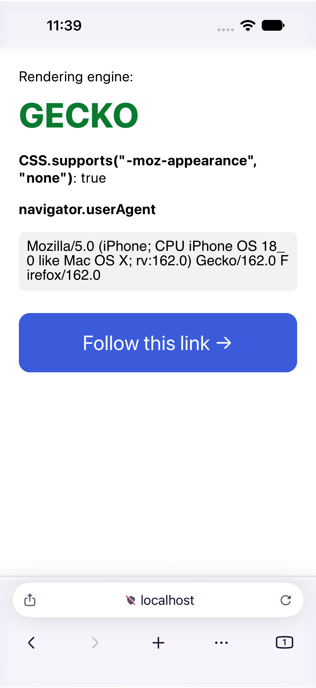

# Firefox iOS on Gecko

This fork swaps WebKit for **Gecko**, Firefox's own engine, inside the real Firefox for iOS app.
It's a personal, dev-signed build that runs on our own devices. It never goes to the App Store,
and nothing here is meant to be sent back upstream.

All of the work is on the `gecko-engine` branch. Gecko needs a few patches of its own, and those
live in [pinecone-dot-website/firefox](https://github.com/pinecone-dot-website/firefox) on the
`ios-gecko-engine` branch.



## Where it stands

- **Simulator:** Fennec browses on Gecko, with the URL bar, back and forward, and tabs.
  A test page confirms the engine is Gecko (`CSS.supports("-moz-appearance", "none")` is true),
  and stock WebKit Fennec fails the same check.
- **iPhone:** runs from a dev-signed build. There are no BrowserEngineKit entitlements, so Gecko
  runs in a single process and all JavaScript is interpreted (no JIT). Scrolling uses hardware
  vsync at ProMotion rates, and HTTPS pages show the lock.
- **Stubbed or untested:** tab thumbnails, content blocking, add-ons, Sync, and session
  restore after a relaunch.

The full log, with screenshots for each milestone, is in
[`gecko-port/RESULT.md`](gecko-port/RESULT.md). The plan and build notes are in
[`gecko-port/PLAN.md`](gecko-port/PLAN.md).

## How it's put together

- `BrowserKit/Sources/GeckoEngine/` implements Firefox iOS's own `WebEngine` protocols
  (`Engine`, `EngineSession`, `EngineView`) on top of GeckoView.
- `firefox-ios/Client/Gecko/` holds the glue that puts that engine inside Fennec.
- Gecko is opt-in. The engine is chosen at compile time with `GECKO_ENGINE_BUILD=YES`, and a
  normal Fennec build stays on WebKit.

## Building

You need Xcode 27.2 and a Gecko checkout from the fork above, built on `ios-gecko-engine`.

```sh
# Gecko, for the simulator (about 15 min clean)
cd mozilla-firefox
MOZCONFIG=../firefox-ios/gecko-port/mozconfig-ios-sim ./mach build

# Fennec on Gecko, for the simulator
firefox-ios/gecko-port/FennecGecko/build.sh [simulator-udid]

# Or for an iPhone: build Gecko with mozconfig-ios-device, then
firefox-ios/gecko-port/FennecGecko/device.sh
```

`device.sh` defaults to one particular phone and bundle ID. Set `DEVICE`, `BUNDLE_ID` and
`PROFILE` for your own, as listed at the top of the script. It refuses stock Firefox bundle
IDs, so it can't install over real Firefox. Fennec also needs an app group in its
provisioning profile; PLAN.md's working notes explain how to set one up.

## License

Same as upstream: MPL-2.0. The [Reynard](https://github.com/minh-ton/reynard-browser)
browser, which ships Gecko on iOS, was read as a reference, but none of its GPL-3.0 code is
copied here.

---

*Upstream's README follows.*

# Firefox for iOS and Focus iOS

Download [Firefox iOS](https://apps.apple.com/app/firefox-web-browser/id989804926) and [Focus iOS](https://itunes.apple.com/app/id1055677337) on the App Store.

<table>
  <tr>
    <th style="border: none;"><strong>Firefox iOS</strong></th>
    <td style="border: none;"></td>
    <td style="border: none;"></td>
    <td style="border: none;"></td>
  </tr>
  <tr>
    <th style="border: none;"><strong>Focus iOS</strong></th>
    <td style="border: none;"></td>
    <td style="border: none;"></td>
    <td style="border: none;"></td>
  </tr>
</table>

## Building the code

This is a monolithic-repository, containing both the Firefox and Focus iOS projects.

As this is an iOS project, it is required to have Xcode on your system, and you should check that `xcode-select -p` points to `/Applications/Xcode.app/Contents/Developer` (or however you've named your `Xcode.app`).

### Automatic Installation (Recommended)
Steps: [Automated Project Setup with FXIOS](https://github.com/mozilla-mobile/firefox-ios/wiki/Automated-Project-Setup-with-FXIOS)

### Manual Installation

1. Clone the repo locally
1. For their related build instructions, please follow the respective project readmes:

- [Firefox for iOS](./firefox-ios/README.md)
- [Focus iOS](./focus-ios/README.md)

## Getting involved

We encourage you to participate in those open source projects. We love Pull Requests, Issue Reports, Feature Requests or any kind of positive contribution. Please read the [Mozilla Community Participation Guidelines](https://www.mozilla.org/en-US/about/governance/policies/participation/) and our [Contributing guidelines](https://github.com/mozilla-mobile/firefox-ios/blob/main/CONTRIBUTING.md) first.

- You can [file a new issue](https://github.com/mozilla-mobile/firefox-ios/issues/new/choose) or research [existing bugs](https://github.com/mozilla-mobile/firefox-ios/issues)

If more information is required or you have any questions then we suggest reaching out to us via:

- Chat on Element channel [#fx-ios](https://chat.mozilla.org/#/room/#fx-ios:mozilla.org) and [#focus-ios](https://chat.mozilla.org/#/room/#focus-ios:mozilla.org) for general discussion, or write DMs to specific teammates for questions.
- Open a [ticket](https://github.com/mozilla-mobile/firefox-ios/issues/new?template=BLANK_ISSUE) with your question.

Want to contribute on the codebase but don't know where to start? Here is a list of [issues that are contributor friendly](https://github.com/mozilla-mobile/firefox-ios/labels/Contributor%20OK), but make sure to read the [Contributing guidelines](https://github.com/mozilla-mobile/firefox-ios/blob/main/CONTRIBUTING.md) first.

## License

    This Source Code Form is subject to the terms of the Mozilla Public
    License, v. 2.0. If a copy of the MPL was not distributed with this
    file, You can obtain one at https://mozilla.org/MPL/2.0/
